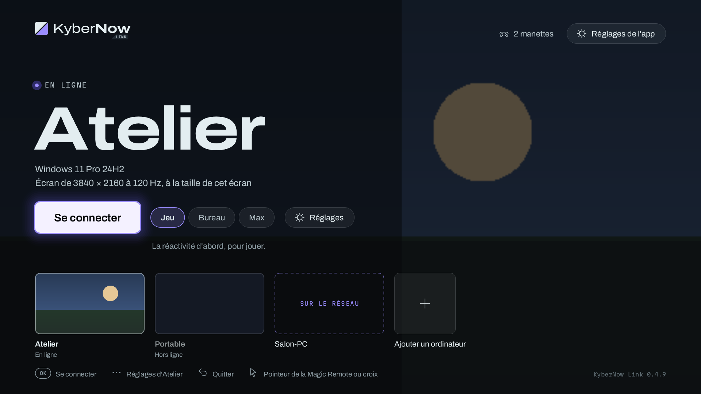

# KyberNow Link pour les téléviseurs LG (webOS)

[English](README.en.md) · Français

KyberNow Link sur les téléviseurs LG : une app **native** (un binaire ARM, pas une page web), sur le même cœur Rust que les autres apps Link (`apps/core`), qui retrouve l'ordinateur (KyberNow Station) en plein écran, à la Magic Remote, au clavier et à la souris ou à la manette. Identité v2 ([charte](../../brand/v2/README.md)) ; maquettes : [Claude Design](https://claude.ai/artifact/2TNZZrYYZpHvdQqLXzSLGv) (accueil, menu de session à la Magic Remote, réglages Image, Réseau et Son, manettes et vibrations) ; écrans et textes communs à toutes les apps Link : [docs/link-ui.md](../../docs/link-ui.md). Installation sur le téléviseur : [INSTALLATION.md](INSTALLATION.md) (mode développeur).

**État (23/10/2026)** : installée sur la G2 (webOS 26) en mode développeur ; session de bout en bout en 4K et 1440p : image, son stéréo et 5.1 Dolby vers un ampli, manette (branchée avant ou après), Magic Remote. Le binaire se construit pour webOS (armv7, glibc 2.12), le paquet `.ipk` aussi, et l'interface est vérifiée par ses captures (sur l'ordinateur, et par le binaire ARM sous émulation). Les rubriques Statistiques et Station des réglages d'un ordinateur ne sont vérifiées que par leurs captures, pas encore sur le téléviseur. Téléviseur d'essai : LG OLED G2 83 pouces (2022). La décision est dans [PROJECT.md](../../PROJECT.md) (« Téléviseurs LG (webOS) »). KyberNow Share (rejoindre et partager) : compilé pour le téléviseur (`build.sh --check`) et vérifié par ses captures et ses tests ; pas encore essayé sur un téléviseur ni avec une vraie Station 0.8.0 (l'image de l'hôte à l'invité, la « Qualité de l'image » avec une vraie Station : « Auto » mesuré sur la dalle, « 4K · 60 Hz » (le décodeur de NDL en 2160p60), le décodeur de NDL qui suit un changement de taille en cours de flux, le son, une manette qui devient la manette suivante de Windows, l'avis des rôles, le panneau avec de vrais invités, le pavé à la télécommande, la rangée de l'accueil qui glisse à la Magic Remote avec beaucoup d'ordinateurs).



## Téléviseurs

- **webOS 5 au moins** (téléviseurs LG de 2020 et après) : le décodeur NDL DirectMedia en API 2, celle que l'app utilise. Cible principale : webOS 22 et après (OLED C2, G2 et suivants), dont les mises à jour webOS Re:New (webOS 24 et 25 sur les modèles 2022).
- **Installation** : en mode développeur (compte LG gratuit, sans root) ; pas de dépôt Homebrew Channel. Le LG Content Store n'est pas visé : il ne publie pas d'app native hors partenaires.
- **Matériel d'essai** : LG OLED G2 83 pouces ; manettes DualSense, Xbox, Shield, Switch Pro.

## Ce que fait l'app

- **Accueil** (`src/ui/home.rs`) : l'ordinateur choisi en plein cadre (l'aperçu d'Admin, assombri hors ligne), son état (« En ligne », « Hors ligne », « Recherche… » ; sondage d'Admin toutes les 8 s), son nom, son système, et l'écran que la session créera, calculé comme elle (« Écran de 3840 × 2160 à 120 Hz, à la taille de cet écran », « Écran de 1920 × 1080 à 60 Hz » sur mesure, « Les écrans de l'ordinateur, tels quels » si la Station n'a pas d'écran virtuel) ; sous le nom, un compte refusé ou une Station réinstallée (certificat changé), avec ce qu'il faut faire : retirer l'ordinateur, puis l'ajouter de nouveau. « Se connecter » (hors ligne : « Réveiller l'ordinateur » quand l'app connaît ses cartes réseau, sinon « Réessayer » ; voir Réveil par le réseau), les profils Jeu, Bureau, Max (« Personnalisé » quand format, débit ou transport s'en écartent ; choisir un profil les remet aux siens) et sa phrase, « Réglages » (ceux de l'ordinateur). En haut à droite : les manettes branchées (« 2 manettes », « Aucune manette »), « Réglages de l'app », même sans ordinateur ajouté, et « Version X disponible ». Tout s'atteint à la croix, sans touche particulière (télécommande tierce, manette) ; la touche « … » (jaune ou bleue, Y de la manette) reste un raccourci vers les réglages de l'ordinateur. En bas, la rangée des ordinateurs (tous : nom, « En ligne » ou « Hors ligne »), ceux trouvés sur le réseau (« Sur le réseau », trois au plus), « Ajouter un ordinateur » et « Rejoindre avec un code ». Quand la rangée est plus large que l'écran elle glisse : la carte qui a le focus est toujours entière (la Magic Remote fait venir la carte coupée au bord en la survolant), et la croix passe par chaque carte, jusqu'à « Rejoindre ».
- **Ajout** (`src/ui/pair.rs`) : code à six chiffres présenté à chaque Station trouvée sur le réseau (mDNS `_kybernow._tcp`, TXT `name` et `fp`) et accepté dans Admin › Appareils Link (compte Kyber propre au téléviseur) ; ou adresse et port d'Admin au pavé (ou au clavier), puis les quatre premiers groupes de l'empreinte à comparer avec ceux d'Admin, puis le code.
- **Session** (`src/ui/session.rs`, `src/device/`) :
  - **Connexion** : le nom de l'ordinateur, les trois étapes (« Préparation de l'écran », « Connexion », « Premières images » ; faites, en cours, à venir) et Annuler, la couture qui s'allume ; puis l'image seule, rien par-dessus. Quand l'image ne vient pas, le cœur redémarre la Station une fois (`Status::StationRestarting`) : « La Station redémarre… » à la place des étapes, qui reprennent ensuite. Un échec avant la première image : « La connexion a échoué » et la raison.
  - **Image** sur le plan vidéo du téléviseur ; la fenêtre de l'app est transparente par-dessus, et ne montre que le menu, les capsules et le pointeur de l'ordinateur.
  - **Menu** par le bouton Retour de la Magic Remote (réglable), l'appui long sur Retour, le bouton rouge, ou L1 + R1 + Start + Select : santé du flux en haut (latence, images par seconde, débit, mode, format, pertes), puis Reprendre, les autres profils, Magic Remote en souris, Manette en souris, Touches (Ctrl + Alt + Suppr, Alt + Tab, touche Windows…), Statistiques (les mesures en haut de l'image), Manettes, Réglages et Se déconnecter. Pendant le menu, les manettes pilotent l'app et l'ordinateur relâche tout. Rappel du mode jeu de la télé (voir plus bas), désactivable.
  - **États** en capsule : reconnexion, image relancée, mode de l'ordinateur changé, image allégée, manette branchée.
  - **Fin** : retour à l'accueil ; une erreur s'affiche avec « Retour à l'accueil ». Une session d'au moins 3 s est gardée pour Statistiques : latence médiane et 95e centile, durée, date, définition, fréquence, format, débit moyen (`LastSession` ; un fichier de la 0.4.x, sans définition ni format à part, se lit encore).
- **KyberNow Share, le partage en local** ([docs/kybernow-share.md](../../docs/kybernow-share.md), textes : [docs/link-ui.md](../../docs/link-ui.md), « Partage » ; cœur : `kybernow_core::share`), mêmes textes que les autres apps ; sur le même réseau, et hors de chez soi par le relais (voir plus bas). L'app n'enregistre pas le lien `kybernow://` : le code et, pour l'hôte, le QR code suffisent.
  - **Rejoindre** (`src/ui/join.rs`) : « Rejoindre avec un code » à côté de « Ajouter un ordinateur » sur l'accueil (deux cartes, la touche verte de la télécommande l'ouvre aussi). L'écran « Rejoindre un partage » : le code à six chiffres, « Votre prénom » (proposé : « LG {modèle} », puis celui de la dernière fois, retenu dans `kybernow.json`), « Qualité de l'image » sous le prénom (cinq pastilles sur une ligne : « Auto » proposé, « Comme l'hôte », « 4K · 60 Hz », « 1080p · 60 Hz », « 720p · 30 Hz » ; la croix passe de l'une à l'autre, OK choisit ; retenue dans `kybernow.json` avec le prénom, les deux seules traces d'un partage ; « Auto » envoie à la Station la sortie du téléviseur (sa dalle en paysage, sa fréquence) et ce que son décodeur suit (HEVC, AV1 s'il l'a, jamais de 4:4:4 ; aucune autre borne connue que la dalle) par `share::auto_quality` : c'est la Station qui tranche et borne par l'image de l'hôte), « Rejoindre ». Un pavé à droite qui suit le champ : les chiffres pour le code (le sixième porte le focus sur « Rejoindre »), les lettres pour le prénom (chiffres, accents, tiret, apostrophe, espace, majuscule) ; les touches chiffrées de la télécommande, un clavier branché et la manette marchent aussi. « Recherche du partage… » : le code part à toutes les Stations trouvées sur le réseau (celles de l'ajout, avec leur empreinte, et les ordinateurs du téléviseur en ligne que le réseau n'annonce pas) par `share::join_checked` (6 s au plus ; le format de l'image de l'hôte ne bloque plus l'entrée : un téléviseur qui ne le lit pas reçoit une image qu'il lit (`share::guest_format`, avec ce que décode le téléviseur : HEVC par NDL, jamais en 4:4:4, AV1 s'il l'a, sinon H.264), au lieu d'être refusé) ; le refus est le texte du cœur sous les champs (« Aucun partage avec ce code sur le réseau. », « Ce partage est complet (quatre invités au plus). », « Trop d'essais de code… »). Retour abandonne : une réponse qui arrive après repart de la Station (`share::leave`), sans rien ouvrir.
  - **Session d'invité** (`SessionUi::guest`, `device/session.rs`, `device/mod.rs::connect_guest`) : titrée « Invité sur {nom} » (connexion, menu), avec `SessionParams::guest` : l'écran et l'image sont ceux de l'hôte, jamais de presse-papiers, jamais de réglage de l'ordinateur. L'invité n'est pas dans la liste des ordinateurs (son « ordinateur » est une enveloppe qui n'entre jamais dans `kybernow.json`), et la fin de session ne garde rien : ni dernière session, ni aperçu. Le menu (Retour de la Magic Remote, qui l'ouvre toujours pour un invité) : latence et statistiques, la tuile « Qualité de l'image » (sous-titre : la qualité reçue, « 1080p · 60 Hz » ; elle ouvre les cinq choix sur l'image, le choisi coché, Retour revient au menu, un choix revient à l'image), « Quitter le partage » ; ni profils, ni réglages de l'ordinateur, ni « Partager » ; Magic Remote en souris, touches et manette en souris seulement avec le clavier et la souris donnés ; la tuile des manettes seulement avec les manettes. Deux droits indépendants (manettes, clavier et souris), que l'hôte donne ou reprend chacun sans toucher à l'autre : « Joueur » dans le menu dès qu'il y en a un, « Spectateur » sinon. Sans les manettes (spectateur, ou clavier et souris seuls), l'invité n'envoie aucune touche de manette, donc pas de combinaison L1 + R1 + Start + Select : Start, Select ou B d'une manette ouvrent aussi le menu (B reste le clic droit en manette en souris : Start et Select seulement). Le rôle change par l'hôte (`Platform::on_share_role`) : l'avis bref (« Vous pouvez jouer à la manette. », « Les manettes sont reprises. », « Vous avez le clavier et la souris. », « Le clavier et la souris sont repris. », « Vous regardez de nouveau. » à la place de l'avis de reprise quand il ne reste aucun droit ; les deux droits changés d'un coup : un seul avis, le droit donné avant le droit repris, les manettes avant le clavier et la souris) et ce que le droit repris n'ouvre plus se ferme. La fin (`on_share_end`) est la raison de la fin : « {hôte} a arrêté le partage. », « {hôte} vous a retiré du partage. », jamais « Reprendre la main ». **Qualité de l'image** : changer de choix en session (`Action::ShareQuality`, `Session::set_share_quality`) ne relance que l'image de l'invité, jamais celle de l'hôte ; le choix est retenu pour la fois suivante, et choisir celui qui est en place ne demande rien. L'image reçue (`Platform::on_share_image`, au départ puis à chaque changement) donne la qualité que la tuile montre (`ShareImage::label`), seulement quand Kyber en sait la taille (sinon le choix, « Auto ») ; l'avis de la Station (« Image allégée pour suivre. », « L'ordinateur ne peut pas faire une image de plus : vous recevez {qualité}. ») s'affiche en capsule. L'hôte voit la qualité de chacun de ses invités (voir « Partager »).
  - **Partager** (`src/ui/share.rs`) : la tuile « Partager » du menu de session, quand la Station le permet (`Info::share`, relue à l'ouverture de la session). Partage impossible (« Le partage demande KyberNow Station 0.8.0 ou plus récente. », « Le partage est coupé sur cet ordinateur (Admin › Appareils Link). ») : la tuile est estompée mais se choisit, et le panneau qu'elle ouvre est réduit à cette raison. Tant qu'Admin n'a pas répondu (début de session), le panneau attend sa réponse (`App::share_known`) au lieu de laisser une tuile muette. Elle ouvre le partage de l'écran principal (`Console::share_open`, compte de l'appareil) et son panneau sur l'image : « Partager {nom} », « Code » (« 123 456 »), le QR code du lien des apps (`qrcodegen`), l'adresse du client web en clair (pas de « Copier le lien » : un téléviseur n'a pas de presse-papiers utile), l'aide, la liste « Invités » (prénom · rôle, l'app de l'invité, sa qualité d'image (« 720p · 30 Hz ») quand ce n'est pas celle de l'hôte (une image à part dont Kyber sait la taille ; une image encore inconnue compte comme celle de l'hôte, rien n'est dit), lecture seule, et « depuis … », et ses deux droits, chacun donné ou repris sans toucher à l'autre : « Donner les manettes » / « Reprendre les manettes », « Donner le clavier et la souris » / « Reprendre le clavier et la souris », puis « Retirer » (une seule demande part à la fois, jusqu'à la réponse d'Admin : deux clics rapides sur les deux droits ne s'annulent pas) ; durée : « moins d'une minute », « 3 min », « 1 h 12 », jamais négative), « Nouveau code », « Arrêter le partage » ; « Quatre invités au plus. » quand les quatre places sont prises. La liste suit le signe de vie de l'hôte (`Platform::on_guests`), sans qu'un signe de vie parti avant une réponse d'Admin ouvre ou ferme le partage à contretemps (8 s après une ouverture, 3 s après un arrêt, comme l'app Mac) ; le sous-titre de la tuile dit « 2 invités » dès qu'il y a un invité, sinon le code (« 123 456 ») quand le partage est ouvert, sinon « Code et QR code ». Retour referme le panneau.
- **KyberNow Share hors de chez soi, et son ordinateur hors de chez soi : le relais** ([docs/relais.md](../../docs/relais.md), textes : [docs/link-ui.md](../../docs/link-ui.md), « Hors de chez vous » et « Partage » ; cœur : `kybernow_core::relay`, `share::join_anywhere`, `share::wait`, `share::cancel`, [apps/core/README.md](../core/README.md), « Relais »). Partager hors de chez soi, et ouvrir son propre ordinateur hors de chez soi, par le relais public (`share.kybernow.app:8443`) ou celui que la Station a choisi ; mêmes écrans et mêmes textes que sur Linux et les autres apps. Sans relais, rien ne change ; `KYBERNOW_RELAY=off` le coupe, `force` y fait passer les sessions même à la maison (pour essayer ; sur le téléviseur, la variable se pose dans l'environnement de l'app).
  - **Rejoindre hors de chez soi** (`device/jobs.rs::share_join`) : « Rejoindre » envoie le code aux Stations du réseau **et en même temps** au relais public et à ceux des ordinateurs du téléviseur (`session::join_relays` : le relais public d'abord, puis `info.relay.server` de chacun, sans doublon) par `share::join_anywhere` : une Station du réseau qui répond en 1,5 s est prise, sans accord à donner ; sinon la Station que donne le relais, de bout en bout. Hors de chez soi l'hôte accepte chaque invité : l'écran reste titré « Rejoindre un partage » (le prénom de l'hôte et le nom de l'ordinateur ne sont connus qu'après l'accord) et montre « En attente de l'accord de l'hôte… » avec « Annuler » (`Target::JoinCancel`, le focus y va ; Retour aussi) ; `share::wait`, un appel tenu 25 s, est rappelé sur un fil tant que l'hôte n'a pas répondu (`Event::SharePending`, puis `Event::ShareJoined`), « Annuler » retire la demande (`share::cancel`, `jobs::share_cancel`). L'hôte accepte : la session d'invité s'ouvre comme sur le réseau, par le relais ; sinon « L'hôte a refusé. », « L'hôte n'a pas répondu. » (120 s), « Le relais ne répond pas. », « Trop de demandes en attente : réessayez dans un instant. » (le texte du cœur, sous « Rejoindre »). Une réponse qui arrive après un abandon repart de la Station (`share::leave`) sans rien ouvrir.
  - **Panneau de l'hôte** (`src/ui/share.rs`) : les demandes venues par le relais (`ShareGuest::pending`) ont leur liste « Demandes » au-dessus des invités : « {prénom} demande à rejoindre », dessous « {app} · hors de chez vous », « Accepter » (`Console::share_accept` : l'invité entre, spectateur) et « Refuser » (son appareil ne redemande pas avant 10 minutes), à la croix et à OK de la télécommande ; le focus du panneau commence sur la première « Accepter ». Une demande ne compte pas parmi les invités (ni la limite de quatre) ; elle a sa place dans le sous-titre de la tuile « Partager » du menu (« 1 demande · 2 invités ») et s'annonce, pendant la session et panneau fermé, d'un avis bref : « {prénom} demande à rejoindre ». Un invité venu par le relais le dit après son app (« iPhone ou iPad · hors de chez vous · depuis 3 min »). L'aide dit « Sur le même réseau ou ailleurs : … Hors de chez vous, vous acceptez chaque invité. » quand le relais tient le code (`relay.state` `joined` ; le QR code et l'adresse sont ceux du relais, avec `relay` et `sid`) ; relais réglé mais injoignable : « Pas encore joignable hors de chez vous. » sous l'aide du même réseau. Le panneau se resserre pour tenir à l'écran (1080 points) : mesures plus serrées, puis le code seul, jusqu'à quatre invités et trois demandes.
  - **Son ordinateur hors de chez soi** : l'app garde `info.relay` de chaque ordinateur dans `kybernow.json` (`Host::relay` : le relais, l'identifiant de la Station chez lui, l'accès actif ; une Station sans relais, ou antérieure, l'efface). Les sessions s'ouvrent en `Route::Auto(route)` (`session::relay_route`, avec l'empreinte d'Admin que l'app connaît) : `info` sur le réseau en 1,5 s, sinon le relais ; une empreinte changée ne bascule jamais. L'accueil dit « Hors de chez vous » à la place de « En ligne » (état de l'ordinateur choisi, rangée des ordinateurs) quand l'ordinateur ne répond pas sur le réseau (un silence du réseau, pas un refus d'Admin) et que le relais le dit connecté (`jobs::away_from_home`, `relay::presence`, au plus toutes les 30 s par ordinateur, seulement quand « Accès hors de chez vous » est actif chez lui) ; le bouton reste « Se connecter ». En session, `Platform::on_route` donne le chemin (`SessionUi::route`) : une tuile « Par le relais » dans le menu (« Par le relais (TCP) » au repli quand l'UDP ne passe pas, l'aller-retour mesuré dessous, « Hors de chez vous » tant qu'il ne l'est pas) et la ligne « Chemin » des statistiques (« Direct », « Par le relais », « Par le relais (TCP) ») ; la dernière session garde le chemin (`LastSession::route`). Les échecs par le relais disent le nom de l'ordinateur (`session::relay_refusal` : « {nom} n'est pas joignable : l'ordinateur est éteint ou en veille. », « {nom} n'est pas joignable hors de chez vous (accès coupé dans Admin). » ; le cœur ne distingue le second que par le message d'Admin, que l'app reconnaît). Hors de chez soi, la Station ne se redémarre ni ne se met à jour depuis l'app (la rubrique Station dit « Hors de chez vous »). Pas encore essayé avec une vraie Station depuis un autre réseau ni sur un téléviseur ; compilé (`scripts/build.sh --check`) et testé pour l'interface et la logique sur le Mac.
- **Manettes** (`src/device/pads.rs`, `src/ui/pads.rs`) : quatre joueurs au plus dans l'ordre d'arrivée, annoncés à l'ordinateur une fois par liaison des entrées (à chaque session et reconnexion, quand la liaison est prête : annoncés plus tôt, ils se perdaient, et annoncés deux fois, l'ordinateur recréait la manette) ; boutons, sticks, gâchettes et croix ; vibrations des deux moteurs demandées par le jeu ; manette en souris (stick gauche pointeur, RT plus vite, LT plus précis, stick droit molette, A / B / X clics gauche, droit, milieu). La Magic Remote, quand webOS la présente comme une manette, est écartée. Écran de test : touches, sticks et gâchettes en direct, vibration d'essai par moteur et aux gâchettes.
- **Magic Remote, clavier, souris** : hors du jeu, le pointeur choisit ce qu'il survole et OK valide, les flèches vont au plus proche dans leur direction ; en jeu, les flèches et OK partent à l'ordinateur (Retour comme Échap si le réglage le veut), ou la Magic Remote devient la souris de l'ordinateur (OK clic gauche, jaune clic droit, molette) ; Magic Remote ou manette en souris, le pointeur de l'ordinateur est toujours dessiné, car Windows sans souris branchée le cache par intermittence (comme sur Android) ; un clavier branché envoie ses touches (codes USB convertis en scancodes de Windows par la table du crate `keycode`, celle de kynput).
- **Réglages** (`src/ui/settings.rs`), deux écrans, rubriques à gauche et lignes à droite. **Réglages de l'app** : ce téléviseur (langue, modèle, écran, décodeur, réseau et plafond de débit, version, versions proposées : stables ou aussi les bêtas) ; manettes (celles branchées, test). **Réglages de {nom}** (l'ordinateur), le profil en tête (Jeu, Bureau, Max, et sa phrase), puis six rubriques :
  - **Image** : définition (comme cet écran, 2160p, 1440p, 1080p, 720p), fréquence (Auto : celle de la dalle ; 30, 60, 120 Hz), format vidéo (Auto : HEVC ; HEVC, H.264, AV1), débit (Auto, ou de 20 à 95 Mbit/s), rappel du mode jeu, VRR (indisponible, expliqué). Ni texte net (4:4:4 : le décodeur du téléviseur ne le lit pas), ni réglage d'écran virtuel (toujours demandé), ni affichage des images.
  - **Son** : Auto, stéréo, 5.1 Dolby, 5.1 PCM, sur l'ordinateur ; état de la sortie 5.1 du téléviseur ; 7.1 indisponible.
  - **Commandes** : manette vue par l'ordinateur (Xbox 360, fidèle), combinaison L1 + R1 + Start + Select, Retour de la Magic Remote.
  - **Réseau** : transport de l'image (Rapide, Fiable ; Bureau est fiable d'office), reconnexion automatique, réveil par le réseau (« Prêt » et l'adresse MAC apprise, ou « Pas encore d'adresse : connectez-vous une fois à cet ordinateur. » ; rien à saisir au téléviseur).
  - **Statistiques** : la dernière session sur le modèle de la carte de l'app Mac (médiane en grand, règle de 0 à 20 ms avec les repères 160, 120 et 60 Hz et la bande de la médiane au 95e centile, « 95 % des images sous … », durée et moment, ce qui a été transmis), ou « Pas encore de session sur cet ordinateur. » ; cet ordinateur (système, carte graphique, adresse d'Admin, empreinte).
  - **Station** : la version de KyberNow Station (« À jour », « Version X disponible »), « Redémarrer la Station », « Mettre à jour la Station » quand la version s'installe depuis un appareil (sinon : elle s'installe sur l'ordinateur, avec l'installateur), le compte (« Accès propre à cet appareil » : tout compte vient ici du code, et Admin le confirme), « Retirer cet ordinateur » (avec confirmation), et le QR code d'Admin (`https://adresse:port/`, `console::admin_url` du cœur ; crate `qrcodegen`), à scanner au téléphone, avec l'adresse en clair. Les appels passent par le cœur (`Console::station_restart`, `station_update`, fil à part dans `src/device/jobs.rs`) ; un appareil en session demande une confirmation (« Redémarrer quand même »), et l'app suit ensuite la Station en la sondant toutes les 2 s : arrêtée puis revenue (redémarrage, 3 min au plus), revenue dans la version visée (mise à jour, 5 min au plus). Une Station 0.4.9 ou plus ancienne : « mettez-la d'abord à jour depuis Admin ».
- **Langues** : français et anglais (`src/i18n.rs`, paires écrites sur place), selon la langue du téléviseur ; réglage Auto / Français / English.

## Image, fréquence et mode jeu

- **Mode de la session** : celui de la dalle (`SDL_webOSGetPanelResolution`, `SDL_webOSGetRefreshRate`), soit 3840 × 2160 à 120 Hz sur une G2 ; une définition ou une fréquence choisie dans les réglages. L'écran virtuel de l'ordinateur est créé à ce mode.
- **30, 60 ou 120 images par seconde** : la dalle ne change pas de fréquence pour une app (webOS n'en donne pas le moyen) ; à 30 ou 60 i/s, chaque image y est montrée 4 ou 2 fois, à intervalles réguliers. 144 Hz : les dalles de 2025 qui l'ont (pas la G2).
- **Format** : HEVC d'office (4K à 120 i/s sur le décodeur des OLED de 2022) ; AV1 seulement jusqu'à 60 i/s (au-delà, les LG le montrent à 60), et seulement si la version de webOS se lit (5 et après) ; H.264 au choix, déconseillé au-delà de 60 i/s.
- **Débit** : le débit du profil (proportionné aux pixels par seconde, comme les autres apps), plafonné à 80 Mbit/s en Ethernet (la prise des LG s'arrête à 100 Mbit/s, environ 93 utiles) et à 95 en Wi-Fi (limite du décodeur sur les puces de 2022 et après). Le lien est lu dans `/sys/class/net`.
- **Mode jeu de la télé** : aucune API ne permet à une app de passer la télé en Optimiseur de jeu ; le menu le rappelle (bouton Réglages de la Magic Remote › Image › Mode › Optimiseur de jeu), et le rappel se coupe.
- **VRR** : LG le réserve aux entrées HDMI, pour toute app interne, native ou web. L'ordinateur envoie ses images au rythme de la dalle.
- **HDR** : pas de HDR. Le décodeur sait l'afficher (`NDL_DirectVideoSetHDRInfo`, HEVC Main10), mais Kyber 0.29 capture en 8 bits, comme sur les autres apps ; l'app n'appelle pas cette fonction.

## Décodage (NDL DirectMedia)

`src/device/ndl.rs`. Ce qui compte, vérifié sur la G2 :

- `libNDL_directmedia.so.1` ouverte par `dlopen`, jamais liée (une dépendance directe empêche l'app de démarrer là où elle manque).
- `NDL_DirectMediaInit` au premier chargement, pas au lancement de l'app.
- Chaque chargement porte un **plan de son amorcé de trames vides de 5 ms** : Opus stéréo (`0xec 0xff 0xfe`), ou PCM 6 voies avec le réglage 5.1 PCM. Sans lui, NDL ne cale pas les images sur leur horodatage, et l'image saccade au-dessus du 1080p sur une dalle à 120 Hz. Le son réel n'y passe qu'en 5.1 PCM (voir Son).
- **Le chargement n'est confirmé (`LOADCOMPLETED`) qu'une fois ce plan nourri** : les trames vides partent par salves jusqu'à la confirmation (en fond passé 500 ms), et aucune image n'est donnée avant (2 s au plus). Une seule trame ne suffit pas : la G2 sous webOS 26 reste alors sur une image noire, sans erreur. Nourri ainsi, le chargement y est confirmé en 141 ms.
- Horodatages en millisecondes depuis le chargement, jamais en arrière.
- **Jamais de vidage** (`NDL_DirectVideoFlushRenderBuffer`) en cours de session : il coupe le plan de son pour le reste de la session. Après une perte, aucune image n'est donnée avant l'image clé suivante, redemandée par le cœur.
- Le jeu de paramètres (SPS/PPS, VPS, en-tête AV1) est placé devant l'image clé qui (re)démarre le décodeur, et redonné devant l'image clé qui suit un nouveau jeu ; un autre format ou une autre taille rechargent NDL.
- Aucune fonction de NDL n'est sûre entre fils : un seul verrou.
- NDL ne dit pas quand une image est montrée : l'instant d'affichage (latence) est estimé d'après les images en attente (`NDL_DirectVideoGetRenderBufferLength`) et la fréquence de la dalle.

## Son

Opus décodé par le moteur du cœur (`apps/core/src/audio` : tampon adaptatif, masquage des pertes), tiré par le rappel de SDL (PulseAudio du téléviseur, 48 kHz, 512 images par rappel) en **stéréo** : un jeu en 5.1 ou 7.1 est mixé par le moteur. L'app demande la stéréo à l'ordinateur (Auto et Stéréo). Le son peut rester sur l'ordinateur.

**5.1 Dolby** (réglage Son › 5.1 Dolby) : l'app demande 6 voies à l'ordinateur, décode l'Opus elle-même, l'encode en **E-AC-3** (Dolby Digital Plus, 640 kbit/s, trames de 1536 images soit 32 ms ; libavcodec réduit à ses encodeurs ac3 et eac3, `src/eac3_shim.c`, `src/device/eac3.rs`) et le donne au décodeur du téléviseur, qui le passe tel quel à l'ampli en eARC (Sortie son numérique en Pass-Through). Vérifié sur la G2 avec un Denon AVC-X3700H le 23/10/2026. C'est la seule voie vers un ampli : les apps du téléviseur font de même, et l'ampli n'accepte pas de PCM multicanal (voir plus bas).

- **Deux chaînes** : l'image reste sur le décodeur de jeu de NDL (`ndl.rs`, transport `DIRECTMEDIA-ES-PLAYER`, faible latence, plan Opus muet qui la cadence, comme en stéréo). Le son a sa propre chaîne, **audio seule** (`src/device/esplayer.rs`) : le lecteur média de LG par sa façade C `NDL_ES_*` (`libNDL_esmedia.so.1` ; signatures lues dans le code machine, même jeu de fonctions de webOS 22 à 26), chargé en `BUFFERSTREAM` (la chaîne des lecteurs de films) avec le seul codec `AC3 PLUS` et `ac3PlusInfo`, sans tampon ajouté, trames horodatées en nanosecondes à leur arrivée. Amorcée d'une trame E-AC-3 de silence toutes les 32 ms jusqu'à sa confirmation (2,5 s au plus), chargée après le décodeur d'image (il prend ses décodeurs d'abord), déchargée avant lui et en fin de session. Sans confirmation, ou sur une erreur en cours de session qui n'est pas un déchargement (voir plus bas) : stéréo par SDL pour le reste de la session.
- **Pourquoi pas une seule chaîne** : le décodeur de jeu ne décode que PCM, MP3 et Opus, et son puits audio plante sur un premier tampon Dolby (rapport de plantage de la G2, `lgao_push_first_event`). Une chaîne `BUFFERSTREAM` à deux flux passe le Dolby, mais ses puits se synchronisent sur l'horloge GStreamer (le décodeur de jeu les en dispense : `game-mode`, `disable-gstsync`) et l'image se cale sur le son : image et commandes en retard (essayé sur la G2). En deux chaînes, l'image garde sa latence et le son porte seul son retard (trame de 32 ms, chaîne du téléviseur, décodage de l'ampli) : un décalage fixe, pas de dérive (chaque trame est horodatée à son arrivée).
- **Déchargement par le téléviseur** : à l'arrêt du son (changement de mode son sur l'ordinateur, par exemple), la politique de ressources du téléviseur décharge ses deux chaînes d'elle-même (`UNLOADCOMPLETED` sans demande). Le décodeur d'image en prend acte (image clé redemandée, rechargement), et un chargement refusé réinitialise NDL (`Quit` puis `Init`) avant un nouvel essai : sans cela, NDL reste en état invalide et toute reconnexion échoue. La chaîne Dolby aussi : au déchargement (son événement, ou une erreur de `NDL_ES_Feed` alors qu'elle marchait), elle se recharge en fond, après le décodeur d'image, amorcée comme au premier chargement (un chargement refusé prend un nouveau lecteur) ; les trames d'ici là sont sautées, et le son ne repasse en stéréo par SDL que si ce rechargement échoue.
- **Crochet** : le binaire exporte `StarfishMediaAPIs::Load` et `Feed` (`src/starfish_hook.c`, `src/device/starfish.rs`) ; les bibliothèques de LG, chargées après, les résolvent dans l'app, qui journalise les documents de chargement et les événements du lecteur (`SMP CB`), puis les remet tels quels au vrai lecteur. Il sert au diagnostic : le document du décodeur de jeu et ses événements sont dans `kybernow.log` (lignes `lecteur :`).

**5.1 PCM** (réglage Son › 5.1 PCM) : 6 voies décodées par l'app et données en PCM S16LE au plan « 6-channel » de NDL, le PCM multicanal du téléviseur vers l'HDMI. Sans délai d'encodage, mais le téléviseur ne le sort que si l'ampli annonce le PCM multicanal par CEC (descripteurs audio) : le Denon AVC-X3700H n'annonce que LPCM 2 voies (AC-3 et E-AC-3 en 5.1 et 7.1), et beaucoup d'amplis font de même. La ligne « Sortie 5.1 du téléviseur » des réglages lit `NDL_DirectAudioSupportMultiChannel`, qui échoue (-1) sur la G2 sous webOS 26 : « inconnue ».

- Le décodage de l'Opus 5.1 par le téléviseur lui-même (plan Opus 6 voies) sort en stéréo : sa sortie passe par le mixeur du téléviseur.
- **Pas de flux brut vers l'ampli** : l'ordinateur envoie de l'Opus, qu'aucun ampli ne décode.
- **Pas de 7.1** : E-AC-3 5.1 au plus par cette voie (l'encodeur `eac3` de libavcodec s'arrête au 5.1) ; l'écran Son le dit.
- **Réglages du téléviseur** : Son › Sortie audio numérique sur **Pass-Through** (« Interconnexion » en français) ; en PCM ou Auto, tout sort en stéréo, apps de LG comprises. Ce réglage peut revenir sur PCM après un redémarrage ou un changement de réglage : à vérifier si l'ampli retombe en stéréo.

## Réveil par le réseau

Admin donne les cartes réseau de l'ordinateur (adresse MAC, adresse IPv4, adresse de diffusion) à chaque sondage réussi ; l'app les garde pour chaque ordinateur dans `kybernow.json` (les anciennes restent si Admin n'en donne plus, avec une Station 0.4.9 par exemple). Hors ligne, « Réveiller l'ordinateur » envoie le paquet de réveil par le cœur (`kybernow_core::wake`, en diffusion et en direct), affiche « Réveil de l'ordinateur… » et sonde l'ordinateur toutes les 2 s, 2 min au plus, jusqu'à ce qu'il réponde. Rien ne se saisit au téléviseur : les cartes s'apprennent à la première connexion. Le réveil doit aussi être permis sur l'ordinateur (Admin › Système).

## Vibrations

Les vibrations du jeu arrivent au cœur (`InputPlatform::rumble`) et partent à la manette du joueur par `SDL_GameControllerRumble` (5 s au plus sans durée, (0, 0) arrête). Sur les téléviseurs LG, les manettes Bluetooth vibrent quand webOS donne leurs moteurs (la DualSense en Bluetooth n'y vibre pas toujours) ; l'écran de test dit pour chaque manette « 2 moteurs » ou « sans vibration », et la vibration d'essai le vérifie. Le jeu ne commande que les deux moteurs (le cœur ne transmet pas de vibration des gâchettes) ; l'écran de test essaie aussi les gâchettes (`SDL_GameControllerRumbleTriggers`) quand la manette en a. Pas de gâchettes adaptatives de la DualSense.

## Architecture

```
apps/webos/
├── src/
│   ├── main.rs          lancement (--preview : captures sur l'ordinateur)
│   ├── preview.rs       captures des écrans avec des données de démonstration
│   ├── app.rs           état de l'interface, navigation spatiale, actions (sans SDL ni cœur)
│   ├── model.rs         ordinateurs, réglages, identité du téléviseur (kybernow.json dans Store::dir)
│   ├── i18n.rs          français et anglais
│   ├── ui/              dessin (tiny-skia, fontdue) : accueil, ajout, réglages (Statistiques,
│   │                    Station et son QR code), manettes, session ; join.rs (rejoindre un
│   │                    partage), share.rs (panneau de l'hôte), quality.rs (qualité de l'image d'un invité)
│   ├── device/          le téléviseur : SDL (fenêtre, événements), NDL (image), son, chaîne Dolby
│   │                    (esplayer, eac3), crochet du lecteur (starfish), session (Platform du cœur),
│   │                    manettes, tâches de fond (Admin, Station, réveil, mDNS, code, mises à jour), journal
│   └── *.c              cales de glibc, encodeur E-AC-3 (libavcodec), crochet du lecteur de LG
├── kyber-patches/       correctif de kynput pour webOS (client seul)
├── sdl-patches/         correctif de la SDL2 de webosbrew (manettes allumées après le lancement)
├── assets/              polices de la charte (instances fixes), logo
├── webos/               appinfo.json, icônes, écran de lancement
└── scripts/             build.sh, package.sh et ipk.py (paquet), preview.sh (captures),
                         fonts.py et images.py (polices et images tirées de la charte)
```

- **Cœur** : `kybernow-core` tel quel ; `src/device/session.rs` est l'équivalent du pont JNI d'Android (`Platform` du cœur : image, son, chaîne d'entrées, états, mesures, pointeur, vibrations).
- **SDL2** : la version webOS de webosbrew (`release-2.30.12-webos.6`), compilée par `build.sh` avec les correctifs d'`apps/webos/sdl-patches` (relecture de `/dev/input` toutes les 3 s en plus du canal netlink, muet dans le bac à sable de l'app : sans elle, une manette allumée après le lancement n'est jamais vue) et embarquée dans le paquet (`lib/`, trouvée par le RPATH `$ORIGIN/../lib`, en `DT_RPATH` pour passer devant l'ancienne SDL du téléviseur). Réglages : Retour et appui long sur Retour à l'app (`SDL_WEBOS_ACCESS_POLICY_KEYS_BACK`, `_EXIT`), manettes laissées en manettes (`SDL_WEBOS_CLOUDGAME_ACTIVE`). Les fonctions de SDL sont déclarées à la main (`src/device/sdl.rs`).
- **Interface** : dessinée en mémoire (tiny-skia pour les formes et les images, fontdue pour le texte) en 1920 × 1080, le plan graphique de webOS, puis envoyée à l'écran par une texture SDL. Pendant la session, la fenêtre est effacée en transparent ; le pointeur de l'ordinateur est une petite texture à part, recomposée sans redessiner l'interface.
- **Polices** : Archivo et Martian Mono de `brand/v2/fonts`, en instances fixes réduites au latin (`scripts/fonts.py`), car fontdue ne lit pas les axes variables.
- **VLC** : kyvlcplayer référence libvlc, jamais appelée : `build.rs` compile une fonction vide par fonction `libvlc_*` de vlc-rs, comme sur Android et iOS.
- **glibc** : le téléviseur a la glibc 2.12 ; `src/glibc_compat.c` fournit `getauxval`, `gettid` et `sendmmsg`, que la bibliothèque standard de Rust demande.
- **kynput** : sur Linux, kynput compile l'injection d'entrées du serveur (libinput, libevdev, X11), absente du téléviseur ; le correctif `kyber-patches/0001` (cfg `kybernow_webos`) le fait se comporter comme sur Android (client seul).

## Compiler

```sh
# Une fois : cible Rust, cargo-c, cmake, Python 3 (et pip install fonttools pillow cairosvg pour les polices et les images).
rustup target add armv7-unknown-linux-gnueabi
cargo install cargo-c --version 0.10.15 --locked

# Le binaire et le paquet (sur Linux x86_64 et sur un Mac Apple Silicon, la chaîne webOS est téléchargée si elle manque) :
apps/webos/scripts/build.sh                  # → apps/webos/dist/fr.leslignesclaires.kybernow_<version>_arm.ipk
apps/webos/scripts/build.sh --check          # cargo check seul
apps/webos/scripts/build.sh --no-package     # binaire seul (--debug : sans optimisation)

# Les écrans sur l'ordinateur, sans téléviseur :
apps/webos/scripts/preview.sh                # → apps/target/webos-preview/*.png
```

`scripts/build.sh` compile la SDL2 de webOS avec les correctifs d'`apps/webos/sdl-patches` dans `third_party/sdl-webos-dist` (recompilée quand un correctif change), applique les correctifs d'`apps/macos/kyber-patches` puis ceux d'`apps/webos/kyber-patches`, compile dans `third_party/kyber-desktop/rootfs-armv7-unknown-linux-gnueabi` libkynput (sans SDL, `cargo cinstall`), libopus 1.6.1 (en code indépendant de la position : le binaire est PIE), libavcodec et libavutil de FFmpeg 7.1.1 réduits aux encodeurs ac3 et eac3 (statiques, LGPL 2.1, licence dans le paquet), pose `libvlc.pc`, puis compile `kybernow-webos` et le met en paquet (`scripts/package.sh` : binaire sans informations de débogage, SDL2, images, licences). Les sources de Kyber 0.29 vont dans `third_party/kyber-desktop` (voir [docs/build-notes.md](../../docs/build-notes.md)).

- **Chaîne** : celle de webosbrew, téléchargée une fois par `build.sh` (puis `./relocate-sdk.sh`) si `WEBOS_TOOLCHAIN` n'est pas posé. Sur Linux x86_64 : `openlgtv/buildroot-nc4` (gcc 16, glibc 2.12, armv7 softfp), dans `third_party/webos-toolchain`. Sur un Mac Apple Silicon (essayé le 23/10/2026) : `arm-webos-linux-gnueabi_sdk-buildroot_darwin-arm64.tar.bz2` de [webosbrew/native-toolchain](https://github.com/webosbrew/native-toolchain) (gcc 12, glibc 2.12), dans `third_party/webos-toolchain-mac`. Ailleurs : `WEBOS_TOOLCHAIN` obligatoire. `package.sh` lancé seul prend la même chaîne, selon la machine (sans la télécharger). `build.sh` ajoute `/opt/homebrew/opt/rustup/bin` au `PATH` s'il existe (rustup de Homebrew). `scripts/cc.sh` donne au compilateur sa racine système et lie libstdc++ en statique.
- **Options de Rust** : `-C target-feature=+neon,+vfp3,-soft-float -C target-cpu=cortex-a73` (la cible « gnueabi » émule sinon le calcul en virgule flottante : dix fois plus lent), `--cfg kybernow_webos`, `--cfg getrandom_backend="linux_raw"`.
- **Paquet** : `scripts/ipk.py` écrit le `.ipk` comme `ares-package` (archive ar : `debian-binary`, `control.tar.gz`, `data.tar.gz` avec `usr/palm/applications/<id>/` et `usr/palm/packages/<id>/packageinfo.json`), sans les outils de LG.
- **Émulation** : `qemu-arm` ne lance pas un binaire lié à la glibc 2.12 du téléviseur (son chargeur plante, même pour un programme C minimal) ; l'aperçu se vérifie avec un binaire statique (`--no-default-features`, `+crt-static`, la cale de glibc en `-C link-arg`, `qemu-arm -cpu max`).

## Mises à jour

`KyberNow-Link-webOS.ipk` est joint à chaque version (`scripts/release.sh`, couvert par le manifeste signé de la version). L'app cherche au lancement puis toutes les 6 heures (`src/device/jobs.rs`, `kybernow_core::update`, comme Android) la dernière version de son canal qui le publie, vérifie le manifeste signé, et l'annonce : « Version X disponible » sur l'accueil, et dans Réglages de l'app › Ce téléviseur (version, versions proposées : stables ou aussi les bêtas). En mode développeur, une app ne peut pas s'installer elle-même : le paquet s'installe depuis l'ordinateur ([INSTALLATION.md](INSTALLATION.md), « Mettre à jour »).

## Journal

`/media/developer/temp/kybernow/kybernow.log` sur le téléviseur (le précédent en `.1`), à côté de `kybernow.json` (ordinateurs et réglages). En mode développeur, `HOME` vaut `/media/developer`, fermé à l'utilisateur de l'app, et son `/tmp` est vidé au redémarrage et invisible en ssh : `temp` est ouvert à tous, survit au redémarrage et à la réinstallation, et se lit en ssh. L'app prend le premier dossier où elle peut écrire parmi `$HOME/conf`, celui-ci et `/tmp/kybernow` (`Store::dir`), et la sortie d'erreur : lignes `image :` (NDL), `son :`, `manettes :`, `session :`, `lecteur :` (crochet du lecteur de LG), avec les messages du cœur. Voir [INSTALLATION.md](INSTALLATION.md) pour le lire.
